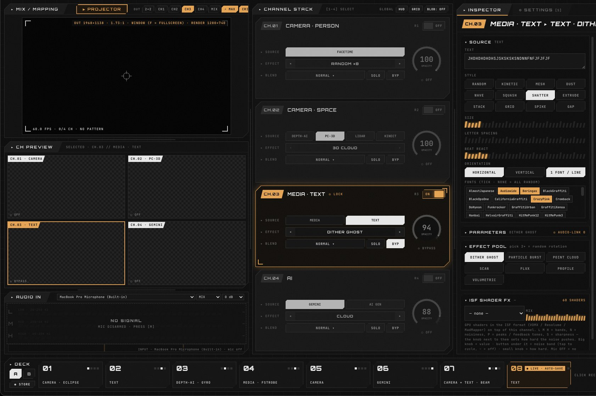
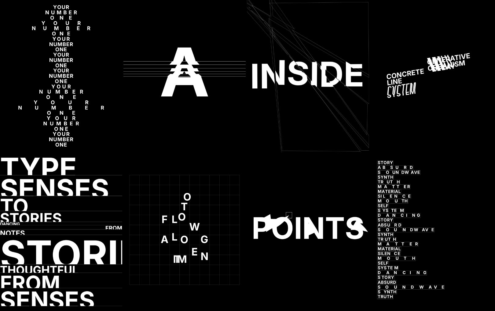

# HVFT VISION

**Live visuals that listen to noise.** A macOS app that mixes four real-time visual channels (camera, depth, text/media and AI) into one projector output, with every effect driven by the sound of a harsh-noise performance.



Built by **HVFT** (Reza, Purwokerto, Indonesia) for his own harsh-noise shows. Most VJ software reacts to beats. Harsh noise has none: it is a continuous wall of sound whose texture keeps changing. HVFT VISION reads that texture (roughness, peaks, sharpness and the low/mid/high balance) every frame, and its effects move smoothly with it instead of flipping on each hit.

> Status: in active development. A free `.dmg` release for Apple Silicon is planned for around November 2026.

---

## Features

- **4 channels → 1 output.**
  - **CH1** camera with the person cut out from the background.
  - **CH2** second camera, AI depth, Kinect v1 or iPhone LiDAR.
  - **CH3** images, video or kinetic text.
  - **CH4** AI restyle.
- **Noise-reactive.** Audio is analysed into LOW / MID / HIGH bands plus Meyda textures **N** (noisiness), **P** (peaks) and **S** (sharpness). With the mic off, nothing moves.
- **Person cut-out.** MediaPipe Selfie Segmenter, or RVM for soft edges, with a background pattern placed behind the body.
- **Depth & 3D.** Depth Anything V2 (ONNX Runtime Web), Kinect v1 via libfreenect, iPhone LiDAR. Point-cloud styles include PRECISE, LIDAR SCAN, VOLUME SCAN, SPECTRAL and 4D.
- **AI on CH4:**
  - **Gemini** (cloud, your own API key).
  - **AI GEN**: local, free, offline Stable Diffusion Turbo on Apple Silicon (PyTorch MPS + diffusers + TAESD).
- **Visual library:**
  - 15 background patterns, including Milkdrop through Butterchurn (245 presets).
  - 60 ISF shaders with knob parameters.
  - 12 kinetic text styles.
  - CHAOS flash, strobe and colour palettes.
- **Stage-ready:**
  - One-click projector that goes fullscreen on the external display automatically and follows hot-plugging.
  - 4-corner mapping and one-click layouts (2×2 / single channel / MIX).
  - HD / CRISP / LITE quality.
- **Presets.** Two decks (A and B) × 8 slots, plus a LIVE slot that auto-saves.
- **I/O:**
  - Syphon output to Resolume, MadMapper or OBS.
  - MIDI learn.
  - **HVFT Cam**: an Android app that turns a phone into a wireless camera (MJPEG over Wi-Fi, found automatically with mDNS).
- **SIMPLE / ADVANCED** inspector. SIMPLE shows *what* to use; ADVANCED adds every slider.



## Requirements

- macOS on Apple Silicon (developed on an M1 Mac, 16 GB)
- Node.js 20+ and npm
- Optional, for AI GEN: Python 3.11+ (conda or Homebrew)
- Optional hardware:
  - audio interface (recommended for noise input)
  - Kinect v1
  - Android phone running HVFT Cam
  - MIDI controller

## Install & run (from source)

```bash
git clone https://github.com/<your-account>/hvft-vision.git
cd hvft-vision
npm install
npm start
```

On the first launch, allow **Camera**, **Microphone** and **Local Network** access. MediaPipe models are bundled in `vendor/models`.

Tip: add a shell alias so you can start the app by typing `hvft`:

```bash
echo 'alias hvft="cd ~/path/to/hvft-vision && npm start"' >> ~/.zshrc
```

### Optional: AI GEN (local Stable Diffusion Turbo)

```bash
cd ai_service
python3 -m venv .venv
source .venv/bin/activate
pip install torch diffusers transformers accelerate pillow
```

The app starts `ai_service/aigen_server.py` itself when you press **▶ START** in CH4 → AI GEN. The first start downloads SD-Turbo and TAESD (about 2.6 GB). See [`ai_service/README.md`](ai_service/README.md).

### Build a .dmg

```bash
npm run dist   # output in ./dist
```

## Quick start

1. Press **M** (or the MIC button) and choose your input under **AUDIO IN**.
2. Turn channels on. In the **INSPECTOR**, pick a SOURCE, an EFFECT (◂ ▸), a BG PATTERN and a COLOR.
3. Set **HOW REACTIVE**. 40 % is already full reaction.
4. Click **▶ PROJECTOR**. It moves to the external display and goes fullscreen. Then pick a layout and use **MAP** to fit the corners.
5. Presets: **⇧-click** saves, **click** recalls, **⌥-click** clears.

| Key | Control window | Projector window |
|---|---|---|
| M | mic on/off | map edit |
| B | blackout | — |
| F | master fade | fullscreen |
| P | next Milkdrop preset | — |
| O / H / R / S | output / HUD / record / settings | — |
| ⇧T | 90 s trace recording | — |
| Tab / Esc | — | next region / exit edit |

The full manual, written in Indonesian, is in [`docs/HVFT_VISION_Deskripsi_Manual.pdf`](docs/HVFT_VISION_Deskripsi_Manual.pdf).

## Project layout

| Path | What it is |
|---|---|
| `main.js`, `preload.js` | Electron main process: windows, displays and the projector, IPC, AI GEN sidecar, HVFT Cam discovery |
| `control.html`, `control.js`, `deck_ui.js` | Control window: the 4-channel deck, inspector and presets |
| `layer_comp.js`, `pipeline.js` | Channel compositor; per-channel camera → segmentation → effects pipeline; audio analysis |
| `proj_view.js` | Projector view: a single render engine with WebGL warp, mapping and blending |
| `effects.js`, `txt_fx2.js`, `fx_extra.js` | Camera effects and kinetic text |
| `bg_*.js`, `chaos_fx.js` | Background patterns, Milkdrop and CHAOS flash |
| `isf_fx.js`, `isf_pack.js` | ISF shader FX and the 60 bundled shaders |
| `pc_*.js`, `depth_*.js`, `kinect/`, `kinect_bridge.js` | Depth, point cloud and Kinect bridge (C) |
| `gemini_engine.js`, `aigen_client.js`, `ai_service/` | AI on CH4 |
| `rvm_*.js`, `netcam_hub.js`, `midi_learn.js`, `syphon_out.js`, `audio_in.js`, `trace_rec.js` | Matting, phone camera, MIDI, Syphon, audio input and the trace recorder |
| `vendor/` | Bundled third-party libraries and models |
| `fonts/`, `backgrounds/`, `collage/`, `characters/` | Visual assets |

## How it was made

HVFT VISION was developed in September and October 2026 as a collaboration between an artist and an AI:

- **Reza (HVFT)**: concept, art direction and live testing.
- **Claude** (Anthropic's AI assistant): wrote and maintained the code.

The work moved in a loop:

1. Reference videos and stage notes.
2. Code changes, with a backup of each file before it was edited.
3. Automated headless tests with mock camera, audio and AI servers.
4. Live tests with real noise.
5. A built-in trace recorder (audio + 4 fps frames) to measure how well each effect follows the sound.

## License

HVFT VISION is free software under the **GNU General Public License v3.0**. See [`LICENSE`](LICENSE).

It is built on the work of others. Third-party components keep their own licenses; see [`THIRD_PARTY_NOTICES.md`](THIRD_PARTY_NOTICES.md).

---

*HVFT · Purwokerto · 2026*
